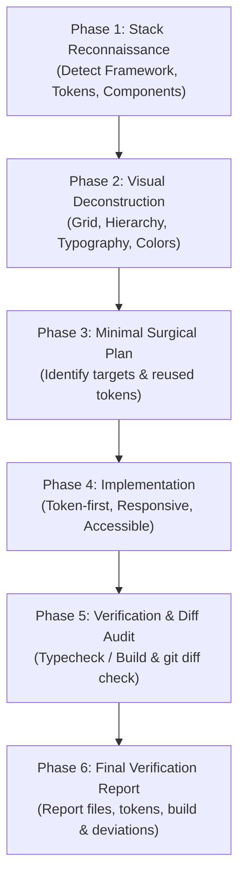

# screenshot-to-code Skill 🌐🎨📱💻

A **Universal, Production-Grade AI Agent Skill** designed for high-fidelity, zero-regression implementation or adjustment of UI screens and components from visual references (Screenshots, Figma, Mockups) across **any modern framework** (React, Next.js, Vue, Flutter, SwiftUI, Jetpack Compose, Angular, Svelte, HTML/Tailwind).

Compatible with **all AI Coding Assistants**: Codex, Claude Code, Cursor, Windsurf, Antigravity, GitHub Copilot, and ChatGPT.

---

## ⚡ Quick Install (ติดตั้งง่าย บรรทัดเดียว)

### 1. ติดตั้งแบบ Global (แนะนำ ⭐️ ใช้ได้กับทุกโปรเจกต์ทุกภาษาในเครื่อง)
```bash
curl -fsSL https://raw.githubusercontent.com/tavanhvannala677-beep/skills-screenshot-to-code-tawan/main/install.sh | bash
```

### 2. ติดตั้งเฉพาะโฟลเดอร์โปรเจกต์ปัจจุบัน (Local Project)
```bash
curl -fsSL https://raw.githubusercontent.com/tavanhvannala677-beep/skills-screenshot-to-code-tawan/main/install.sh | bash -s -- --local
```

---

## 🛡️ ปิดทุกช่องโหว่ด้วย Non-Negotiable Guardrails (Zero Loopholes)

1. **Zero Unauthorized Dependencies**: ห้าม AI แอบรัน `npm install`, `pub add`, หรือเพิ่ม library ภายนอกเองโดยไม่ได้รับอนุญาต
2. **Design Token & Component First**: บังคับสแกนและดึง Theme Tokens, Colors, Spacing และ Reusable Components เดิมมาใช้ ห้าม Hardcode สีหรือสร้าง Component ซ้ำซ้อน
3. **Strict Scope Isolation**: แก้ไขเฉพาะหน้าจอ/คอมโพเนนต์เป้าหมาย ไม่แตะไฟล์อื่น ไม่รัน Linter จัดหน้าทั้งโปรเจกต์จน diff บวม
4. **Responsive & Safe Area Integrity**: ห้ามใส่ขนาดตายตัว (Fixed width/height) ตามเครื่องในรูป ต้องรองรับ Responsive และเคารพ Safe Area Insets (รอยบาก/แถบสถานะ)
5. **State & Contract Completeness**: รองรับ State พื้นฐาน (Loading, Empty, Error) และไม่แก้ไข Data Contract หรือ API ร่วมโดยพลการ
6. **Honest Verification**: รัน Typecheck/Build ตาม Framework หากสภาพแวดล้อมทำไม่ได้ต้องรายงาน `Build/Test: NOT RUN` พร้อมเหตุผลแท้จริง

---

## 📋 6-Phase Mandatory Workflow



---

## 🚀 วิธีใช้งานใน AI Agents (Prompt Template)

ใน AI Agent ของคุณ (เช่น Codex, Cursor, Claude Code) ให้พิมพ์คำสั่งและแนบภาพ:

```text
Use the $screenshot-to-code skill.
Implement or adjust the [ชื่อหน้าจอ เช่น CheckoutScreen / ProfileView] based on the attached screenshot/Figma.

Requirements:
- Auto-detect and strictly adhere to the project's existing framework and styling conventions.
- Match layout, typography, colors, borders, and spacing from the reference.
- Inspect and reuse existing design system components and theme tokens.
- Do NOT install unauthorized packages.
- Modify only the required files.
- Run typecheck/build if possible, or report NOT RUN with reason.
- Provide a summary of files modified, reused tokens, and any visual discrepancies.
```

---

## 📄 License

This project is licensed under the [MIT License](./LICENSE) - free to use, modify, and distribute.
