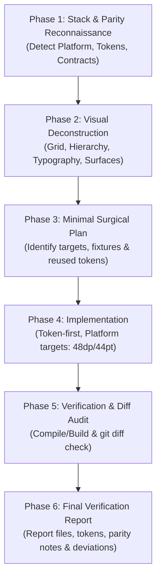

# screenshot-to-code Skill 🌐🎨📱💻

[English](#english) | [ພາສາລາວ](#ພາສາລາວ)

---

<a name="english"></a>
## 🇬🇧 English

A **Universal, Production-Grade AI Agent Skill** designed for high-fidelity implementation or adjustment of UI screens and components from visual references (Screenshots, Figma, Mockups) across modern platforms:
- **Android**: Jetpack Compose (Kotlin)
- **iOS**: SwiftUI / UIKit (Swift)
- **HarmonyOS**: ArkTS / ArkUI
- **Cross-Platform & Web**: Flutter, React, Next.js, Vue, Tailwind CSS, Svelte, HTML5

Compatible with **all AI Coding Assistants**: Codex, Claude Code, Cursor, Windsurf, Antigravity, GitHub Copilot, and ChatGPT.

### ⚡ Quick Install (One-Line Command)

#### 1. Global Installation (Recommended ⭐️ works for all projects)
```bash
curl -fsSL https://raw.githubusercontent.com/tavanhvannala677-beep/skills-screenshot-to-code-tawan/main/install.sh | bash
```

#### 2. Local Project Installation
```bash
curl -fsSL https://raw.githubusercontent.com/tavanhvannala677-beep/skills-screenshot-to-code-tawan/main/install.sh | bash -s -- --local
```

### 🛡️ Non-Negotiable Guardrails (Zero Loopholes)

1. **Zero Unauthorized Dependencies**: The AI must NEVER run `npm install`, `pub add`, or add third-party dependencies to Gradle, Cocoapods, SPM, or ohpm without explicit user permission.
2. **Design Token & Component First**: Mandates scanning and reusing existing project Theme Tokens, colors, typography, spacing, and reusable components. Hardcoding raw hex colors or duplicate primitives is strictly prohibited.
3. **Feature Contracts & Cross-Platform Parity**: Align with project-specific rules, acceptance criteria, and **Feature Contract / Parity Records**. In multi-platform ecosystems (Android + iOS + HarmonyOS), deliver parity across companion platforms in sync rather than isolated silos.
4. **Platform-Accurate Touch Targets & Safe Area**:
   - Android (Material): minimum **48x48 dp**
   - iOS (SwiftUI): minimum **44x44 pt**
   - HarmonyOS (ArkUI): minimum **48x48 vp** (verify target SDK & device profile, e.g. Phone/Tablet/2-in-1)
   - Web: minimum **44x44 px**
   - Respect Safe Area Insets (notches, dynamic island, status bars). Do not hardcode device dimensions.
5. **No Synthetic Mock Data**: DO NOT invent arbitrary data models or mock states without agreed fixtures or schema contracts.
6. **Honest Verification (No Hype)**: Run appropriate typechecks or builds. Never claim "pixel-perfect" or "zero regression" without real verification. If environment restricts execution, report `Build/Test: NOT RUN` with the exact reason.

### 📋 6-Phase Mandatory Workflow



### 🚀 Usage in AI Agents (Prompt Template)

In your AI Agent (e.g. Codex, Cursor, Claude Code), prompt with your screenshot or Figma export:

```text
Use the $screenshot-to-code skill.
Implement or adjust the [Target Screen Name, e.g. WalletScreen / CheckoutView] based on the attached screenshot/Figma.

Requirements:
- Auto-detect and strictly adhere to the project's existing framework and styling conventions.
- Align with existing design system components, theme tokens, and data contracts.
- Respect platform touch target standards (48dp for Android, 44pt for iOS).
- Do NOT install unauthorized packages or invent synthetic mock data.
- Modify only the required files and record cross-platform parity notes if applicable.
- Run typecheck/build if possible, or report NOT RUN with reason.
- Provide a summary of files modified, reused tokens, and any visual discrepancies.
```

---

<a name="ພາສາລາວ"></a>
## 🇱🇦 ພາສາລາວ (Lao)

ສະກິວ AI Agent ລະດັບ **Production ແບບສາກົນ (Universal)** ທີ່ຖືກອອກແບບມາເພື່ອສ້າງ ຫຼື ປັບແຕ່ງໜ້າຈໍ ແລະ Component ຂອງ UI ຈາກຮູບພາບ (Screenshot, Figma, Mockups) ໃຫ້ກົງກັບຕົ້ນສະບັບຢ່າງຖືກຕ້ອງ ພ້ອມທັງຮັກສາໂຄງສ້າງ ແລະ Design System ເດີມຂອງໂປຣເຈັກ ຮອງຮັບທຸກ Platform:
- **Android**: Jetpack Compose (Kotlin)
- **iOS**: SwiftUI / UIKit (Swift)
- **HarmonyOS**: ArkTS / ArkUI
- **Cross-Platform & Web**: Flutter, React, Next.js, Vue, Tailwind CSS, Svelte, HTML5

ຮອງຮັບການໃຊ້ງານຮ່ວມກັບ **AI Coding Assistants ທຸກໂຕ**: Codex, Claude Code, Cursor, Windsurf, Antigravity, GitHub Copilot, ແລະ ChatGPT.

### ⚡ ວິທີຕິດຕັ້ງງ່າຍໆ ພຽງແຖວດຽວ (Quick Install)

#### 1. ຕິດຕັ້ງແບບ Global (ແນະນຳ ⭐️ ໃຊ້ໄດ້ກັບທຸກໂປຣເຈັກໃນເຄື່ອງ)
```bash
curl -fsSL https://raw.githubusercontent.com/tavanhvannala677-beep/skills-screenshot-to-code-tawan/main/install.sh | bash
```

#### 2. ຕິດຕັ້ງສະເພາະໂຟນເດີໂປຣເຈັກປັດຈຸບັນ (Local Project)
```bash
curl -fsSL https://raw.githubusercontent.com/tavanhvannala677-beep/skills-screenshot-to-code-tawan/main/install.sh | bash -s -- --local
```

### 🛡️ ປິດທຸກຊ່ອງວ່າງດ້ວຍກົດເຫຼັກ (Non-Negotiable Guardrails)

1. **ຫ້າມລົງ Package ເອງ (Zero Unauthorized Dependencies)**: ຫ້າມບໍ່ໃຫ້ AI ແອບລັນ `npm install`, `pub add`, ຫຼື ເພີ່ມ dependency ໃນ Gradle, Cocoapods, SPM, ohpm ເດັດຂາດໂດຍບໍ່ໄດ້ຮັບອະນຸຍາດ.
2. **ນຳໃຊ້ Theme Tokens & Components ເດີມກ່ອນສະເໝີ**: ບັງຄັບໃຫ້ກວດສອບ ແລະ ດຶງເອົາ Theme Tokens, ສີ, ຂະໜາດຕົວໜັງສື, ໄລຍະຫ່າງ (Spacing) ແລະ Components ທີ່ມີຢູ່ແລ້ວໃນໂປຣເຈັກມາໃຊ້ຄືນ.
3. **ປະຕິບັດຕາມ Feature Contract & Parity ຂ້າມ Platform**: ຮອງຮັບໂປຣເຈັກໃຫຍ່ທີ່ຕ້ອງເຮັດທັງ Android, iOS ແລະ HarmonyOS ໃຫ້ສອດຄ່ອງກັບ Feature Contract / Parity Record ແລະ ສົ່ງມອບວຽກພ້ອມກັນຢ່າງເປັນລະບົບ.
4. **ຂະໜາດ Touch Target ຖືກຕ້ອງຕາມ Platform & Safe Area**:
   - Android (Material): ຢ່າງໜ້ອຍ **48x48 dp**
   - iOS (SwiftUI): ຢ່າງໜ້ອຍ **44x44 pt**
   - HarmonyOS (ArkUI): ຢ່າງໜ້ອຍ **48x48 vp** (ກວດສອບຕາມ Target SDK & Device Profile)
   - Web: ຢ່າງໜ້ອຍ **44x44 px**
   - ເຄົາລົບ Safe Area (ຮອຍບາກ, Dynamic Island, ແຖບສະຖານະ) ຫ້າມໃສ່ຂະໜາດ fixed ຕາມຮູບ screenshot.
5. **ຫ້າມສ້າງ Mock Data ຂຶ້ນມາເອງ**: ຫ້າມສ້າງ model ຫຼື ຂໍ້ມູນສົມມຸດຂຶ້ນມາເອງໂດຍບໍ່ມີ fixture ຫຼື contract ທີ່ຕົກລົງກັນໄວ້.
6. **ລາຍງານຜົນຕາມຄວາມຈິງ (ຫ້າມໂຄສະນາເກີນຈິງ)**: ຫ້າມອ້າງວ່າ "pixel-perfect" ຫຼື "zero regression" ຖ້າບໍ່ໄດ້ render ກວດສອບຕົວຈິງ. ຫາກສະພາບແວດລ້ອມລັນ Build/Test ບໍ່ໄດ້ ຕ້ອງລາຍງານວ່າ `Build/Test: NOT RUN` ພ້ອມເຫດຜົນ.

### 📋 ຂັ້ນຕອນການເຮັດວຽກ 6 ໄລຍະ (6-Phase Workflow)

1. **Phase 1: ສຳຫຼວດ Platform, Stack ແລະ Contract**: ກວດສອບ Platform (Compose/SwiftUI/ArkTS), Styling, Tokens, Component Library ແລະ API Contracts.
2. **Phase 2: ວິເຄາະຮູບພາບອ້າງອິງ**: ແຍກໂຄງສ້າງ Layout, Grid, Typography, ສີ ແລະ Interactive Components.
3. **Phase 3: ວາງແຜນແບບເຈາະຈົງ**: ກຳນົດໄຟລ໌ທີ່ຕ້ອງແກ້ໄຂ, Fixtures ຂໍ້ມູນ ແລະ Components ທີ່ຕ້ອງດຶງມາໃຊ້ຄືນ.
4. **Phase 4: ລົງມືຂຽນໂຄ້ດ**: ປະກອບ Layout ດ້ວຍ Semantic Containers, ໃຊ້ Theme Tokens ແລະ ໃຊ້ Touch Target ຖືກຕາມ Platform (48dp/44pt).
5. **Phase 5: ກວດສອບ Build ແລະ Git Diff**: ລັນ Typecheck/Build ຕາມ Platform ແລະ ກວດສອບ `git diff` ເພື່ອຢືນຢັນວ່າບໍ່ມີໄຟລ໌ອື່ນຖືກກະທົບ.
6. **Phase 6: ລາຍງານຜົນສະຫຼຸບ**: ສະຫຼຸບໄຟລ໌ທີ່ປ່ຽນແປງ, Tokens ທີ່ນຳໃຊ້, ຂໍ້ສັງເກດ Parity ຂ້າມ Platform, ແລະ ຜົນການ Build/Test ຕົວຈິງ.

### 🚀 ຕົວຢ່າງ Prompt ສຳລັບສັ່ງງານ AI (Codex, Cursor, Claude Code)

```text
Use the $screenshot-to-code skill.
Implement or adjust the [ຊື່ໜ້າຈໍ ເຊັ່ນ WalletScreen / CheckoutView] based on the attached screenshot/Figma.

Requirements:
- Auto-detect and strictly adhere to the project's existing framework and styling conventions.
- Align with existing design system components, theme tokens, and data contracts.
- Respect platform touch target standards (48dp for Android, 44pt for iOS).
- Do NOT install unauthorized packages or invent synthetic mock data.
- Modify only the required files and record cross-platform parity notes if applicable.
- Run typecheck/build if possible, or report NOT RUN with reason.
- Provide a summary of files modified, reused tokens, and any visual discrepancies.
```

---

## 📄 License

This project is licensed under the [MIT License](./LICENSE) - free to use, modify, and distribute.
