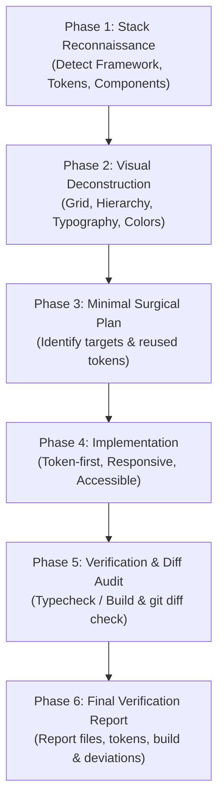

# screenshot-to-code Skill 🌐🎨📱💻

[English](#english) | [ພາສາລາວ](#ພາສາລາວ)

---

<a name="english"></a>
## 🇬🇧 English

A **Universal, Production-Grade AI Agent Skill** designed for high-fidelity, zero-regression implementation or adjustment of UI screens and components from visual references (Screenshots, Figma, Mockups) across **any modern framework** (React, Next.js, Vue, Flutter, SwiftUI, Jetpack Compose, Angular, Svelte, HTML/Tailwind).

Compatible with **all AI Coding Assistants**: Codex, Claude Code, Cursor, Windsurf, Antigravity, GitHub Copilot, and ChatGPT.

### ⚡ Quick Install (One-Line Command)

#### 1. Global Installation (Recommended ⭐️ works for all projects)
```bash
curl -fsSL https://raw.githubusercontent.com/tavanhvannala677-beep/skills-screenshot-to-code-tawan/main/install.sh | bash
```

#### 2. Local Project Installation
```bash
curl -fsSL https://raw.githubusercontent.com/tavanhvannala677-beep/skills-screenshot-to-code-tawan/main/install.sh | bash -s -- --local
```

### 🛡️ Non-Negotiable Guardrails (Zero Loopholes)

1. **Zero Unauthorized Dependencies**: The AI must NEVER run `npm install`, `pub add`, or add third-party dependencies without explicit user permission.
2. **Design Token & Component First**: Mandates scanning and reusing existing project Theme Tokens, colors, typography, spacing, and reusable components. Hardcoding raw hex colors or duplicate primitives is strictly prohibited.
3. **Strict Scope Isolation**: Modify ONLY target screens or components. Never refactor unrelated screens, global stores, or run full-repo formatters that pollute Git diffs.
4. **Responsive & Safe Area Integrity**: Do NOT hardcode fixed dimensions (e.g. `375px x 812px`) based on the screenshot device. Enforce responsive layout and respect Safe Area Insets (notches, status bars).
5. **State & Contract Completeness**: Account for core UI states (Loaded, Empty, Loading, Error). Do not alter backend data contracts or API schemas unilaterally.
6. **Honest Verification**: Run appropriate typechecks or builds. If the environment prevents execution, report `Build/Test: NOT RUN` with the exact reason.

### 📋 6-Phase Mandatory Workflow



### 🚀 Usage in AI Agents (Prompt Template)

In your AI Agent (e.g. Codex, Cursor, Claude Code), prompt with your screenshot or Figma export:

```text
Use the $screenshot-to-code skill.
Implement or adjust the [Target Screen Name, e.g. CheckoutScreen / ProfileView] based on the attached screenshot/Figma.

Requirements:
- Auto-detect and strictly adhere to the project's existing framework and styling conventions.
- Match layout, typography, colors, borders, and spacing from the reference.
- Inspect and reuse existing design system components and theme tokens.
- Do NOT install unauthorized packages.
- Modify only the required files.
- Run typecheck/build if possible, or report NOT RUN with reason.
- Provide a summary of files modified, reused tokens, and any visual discrepancies.
```

---

<a name="ພາສາລາວ"></a>
## 🇱🇦 ພາສາລາວ (Lao)

ສະກິວ AI Agent ລະດັບ **Production ແບບສາກົນ (Universal)** ທີ່ຖືກອອກແບບມາເພື່ອສ້າງ ຫຼື ປັບແຕ່ງໜ້າຈໍ ແລະ Component ຂອງ UI ຈາກຮູບພາບ (Screenshot, Figma, Mockups) ໃຫ້ກົງກັບຕົ້ນສະບັບຢ່າງຖືກຕ້ອງ ແລະ ບໍ່ກະທົບໂຄງສ້າງເດີມ ຮອງຮັບ**ທຸກໆ Framework ທັນສະໄໝ** (React, Next.js, Vue, Flutter, SwiftUI, Jetpack Compose, Angular, Svelte, HTML/Tailwind).

ຮອງຮັບການໃຊ້ງານຮ່ວມກັບ **AI Coding Assistants ທຸກໂຕ**: Codex, Claude Code, Cursor, Windsurf, Antigravity, GitHub Copilot, ແລະ ChatGPT.

### ⚡ ວິທີຕິດຕັ້ງງ່າຍໆ ພຽງແຖວດຽວ (Quick Install)

#### 1. ຕິດຕັ້ງແບບ Global (ແນະນຳ ⭐️ ໃຊ້ໄດ້ກັບທຸກໂປຣເຈັກໃນເຄື່ອງ)
```bash
curl -fsSL https://raw.githubusercontent.com/tavanhvannala677-beep/skills-screenshot-to-code-tawan/main/install.sh | bash
```

#### 2. ຕິດຕັ້ງສະເພາະໂຟນເດີໂປຣເຈັກປັດຈຸບັນ (Local Project)
```bash
curl -fsSL https://raw.githubusercontent.com/tavanhvannala677-beep/skills-screenshot-to-code-tawan/main/install.sh | bash -s -- --local
```

### 🛡️ ປິດທຸກຊ່ອງວ່າງດ້ວຍກົດເຫຼັກ (Non-Negotiable Guardrails)

1. **ຫ້າມລົງ Package ເອງ (Zero Unauthorized Dependencies)**: ຫ້າມບໍ່ໃຫ້ AI ແອບລັນ `npm install`, `pub add`, ຫຼື ເພີ່ມ dependency ພາຍນອກເອງໂດຍບໍ່ໄດ້ຮັບອະນຸຍາດເດັດຂາດ.
2. **ນຳໃຊ້ Theme Tokens & Components ເດີມກ່ອນສະເໝີ**: ບັງຄັບໃຫ້ກວດສອບ ແລະ ດຶງເອົາ Theme Tokens, ສີ, ຂະໜາດຕົວໜັງສື, ໄລຍະຫ່າງ (Spacing) ແລະ Components ທີ່ມີຢູ່ແລ້ວໃນໂປຣເຈັກມາໃຊ້ຄືນ ຫ້າມ hardcode ສີ ຫຼື ສ້າງ component ຊ້ຳຊ້ອນ.
3. **ຈຳກັດຂອບເຂດຢ່າງເຄັ່ງຄັດ (Strict Scope Isolation)**: ແກ້ໄຂສະເພາະໜ້າຈໍ ຫຼື Component ທີ່ລະບຸເທົ່ານັ້ນ ບໍ່ແກ້ໄຂໜ້າຈໍອື່ນ, ບໍ່ແຕະ State ສ່ວນກາງ, ແລະ ບໍ່ລັນ format ທັງໂປຣເຈັກຈົນ Git Diff ປ່ຽນແປງເກີນຄວາມຈຳເປັນ.
4. **ຮອງຮັບ Responsive ແລະ Safe Area**: ຫ້າມໃສ່ຂະໜາດແບບຕາຍໂຕ (Fixed width/height) ຕາມຂະໜາດໜ້າຈໍໃນຮູບ ຕ້ອງຮອງຮັບ Responsive ແລະ ເຄົາລົບ Safe Area (ຮອຍບາກ, ແຖບສະຖານະ).
5. **ຮອງຮັບ State ຢ່າງຄົບຖ້ວນ**: ຮອງຮັບ State ພື້ນຖານ (Loaded, Empty, Loading, Error) ແລະ ຫ້າມປ່ຽນແປງ Data Contract ຫຼື API ຫຼັກໂດຍພະການ.
6. **ລາຍງານຜົນຕາມຄວາມຈິງ**: ລັນ Typecheck ຫຼື Build ຕາມ Framework ຫາກສະພາບແວດລ້ອມບໍ່ເອື້ອອຳນວຍໃຫ້ລັນ ຕ້ອງລາຍງານວ່າ `Build/Test: NOT RUN` ພ້ອມເຫດຜົນຕົວຈິງ.

### 📋 ຂັ້ນຕອນການເຮັດວຽກ 6 ໄລຍະ (6-Phase Workflow)

1. **Phase 1: ສຳຫຼວດ Stack ແລະ ໂຄງສ້າງ**: ກວດສອບ Framework, Styling, Theme Tokens, Component Library ແລະ ລະບົບ Routing.
2. **Phase 2: ວິເຄາະຮູບພາບອ້າງອິງ**: ແຍກໂຄງສ້າງ Layout, Grid, Typography, ສີ ແລະ Component ຕ່າງໆ.
3. **Phase 3: ວາງແຜນແບບເຈາະຈົງ**: ກຳນົດໄຟລ໌ທີ່ຕ້ອງແກ້ໄຂ ແລະ Components ທີ່ຕ້ອງດຶງມາໃຊ້ຄືນກ່ອນລົງມືຂຽນ.
4. **Phase 4: ລົງມືຂຽນໂຄ້ດ**: ປະກອບ Layout ດ້ວຍ Semantic Containers, ໃຊ້ Theme Tokens ແລະ ຄຳນຶງເຖິງ Responsive ແລະ Accessibility.
5. **Phase 5: ກວດສອບ Build ແລະ Git Diff**: ລັນ Typecheck/Build ແລະ ກວດສອບ `git diff` ເພື່ອຢືນຢັນວ່າບໍ່ມີໄຟລ໌ອື່ນຖືກກະທົບ.
6. **Phase 6: ລາຍງານຜົນສະຫຼຸບ**: ສະຫຼຸບໄຟລ໌ທີ່ປ່ຽນແປງ, Tokens ທີ່ນຳມາໃຊ້, ຜົນການ Build/Test ແລະ ຈຸດທີ່ຍັງແຕກຕ່າງຈາກຮູບ (ຖ້າມີ).

### 🚀 ຕົວຢ່າງ Prompt ສຳລັບສັ່ງງານ AI (Codex, Cursor, Claude Code)

ພິມຄຳສັ່ງນີ້ໃນ AI Agent ຂອງທ່ານ ພ້ອມກັບແນບຮູບ Screenshot ຫຼື Figma:

```text
Use the $screenshot-to-code skill.
Implement or adjust the [ຊື່ໜ້າຈໍ ເຊັ່ນ CheckoutScreen / ProfileView] based on the attached screenshot/Figma.

Requirements:
- Auto-detect and strictly adhere to the project's existing framework and styling conventions.
- Match layout, typography, colors, borders, and spacing from the reference.
- Inspect and reuse existing design system components and theme tokens.
- Do NOT install unauthorized packages.
- Modify only the required files.
- Run typecheck/build if possible, or report NOT RUN with reason.
- Provide a summary of files modified, reused tokens, and any visual discrepancies.
```

---

## 📄 License

This project is licensed under the [MIT License](./LICENSE) - free to use, modify, and distribute.
